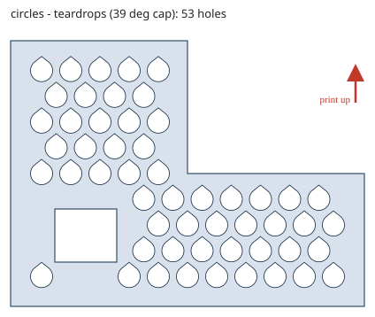
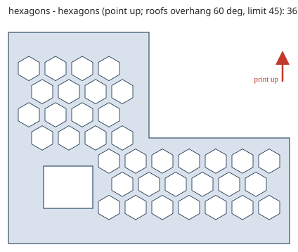
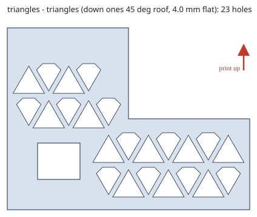

# Printable Pattern (Onshape FeatureScript)

A custom Onshape feature that cuts **circle, hexagon or triangle** hole patterns into a face or
sketch region, with every hole shaped to print on an FDM printer **without supports**.

You give it the print direction, a max overhang angle (default 45°) and a max bridge width; it picks
hole shapes that respect them:

| Holes vs print axis | Circles | Hexagons | Triangles |
| --- | --- | --- | --- |
| Along the print axis (plate printed flat) | circles | regular hexagons, corner up (always the default; a stretched style respects the limit) | full isogrid |
| Across it (wall printed upright) | circles, or teardrops with a bridge-width flat top | regular, corner up: roofs overhang 60° | down triangles keep their height: top corners cut, flat top of the bridge width |
| Tilted beyond the overhang limit | pointed teardrops | regular, corner up | steeper sides, peaked down triangles |

Print up = red arrow, 45° overhang, 4 mm max bridge. Left: holes tilted 65° from the print axis (teardrops). Middle and right: wall printed upright.

  

More in [`docs/previews/`](docs/previews/README.md) (rendered from the same math the feature uses).
One-page user guide: [`docs/Printable_Pattern_User_Guide.pdf`](docs/Printable_Pattern_User_Guide.pdf)
(rebuild with `python tools/make_user_guide.py`).

## Knurl (second feature)

`src/Knurl.fs` is a separate feature for its own Feature Studio: diamond, helical or straight V
grooves that wrap around a cylindrical face, on a shaft or in a bore. First draft, not yet tried
in Onshape. See [`docs/KNURL.md`](docs/KNURL.md).

## Install

1. In an Onshape document, create a Feature Studio and paste in `src/PatternMaker.fs`.
2. If the studio's own header shows a different `FeatureScript <n>;` version, keep that number.
3. Commit. **Printable Pattern** appears in the Part Studio's custom features.

## Use

Select the faces (split a face first to pattern just part of it) or sketch regions, pick a pattern and
cell size, and set the print direction (the build plate's plane, or any planar face, edge or mate
connector). For a curved face, also pick a cut direction: the holes go straight through along it. The info line under the feature reports how many cells were cut and which shapes it chose.

## Onshape document

[Printable Pattern](https://cad.onshape.com/documents/00017844b4d3d67d1d1fe858/w/27782954c89d9a7430469def/e/5862b397c8f31bc376fb5c81)
— test Part Studio and the Feature Studio this repo's `src/PatternMaker.fs` is pasted into.

## Status

Working in Onshape on planar faces (2026-10-11); curved faces are new and untested. See [`HANDOFF.md`](HANDOFF.md) for state and
the validation plan, [`docs/SPEC.md`](docs/SPEC.md) and [`docs/DESIGN.md`](docs/DESIGN.md) for details.

## Repo layout

| Path | What |
| --- | --- |
| `src/PatternMaker.fs` | The feature |
| `tools/` | Python twin of the pattern math, its tests, the preview renderer and the user-guide builder |
| `docs/` | Spec, design, previews |
