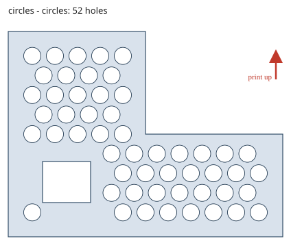
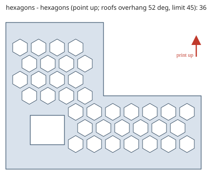
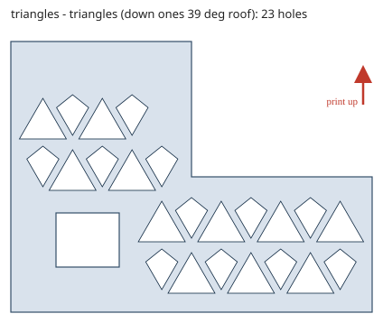
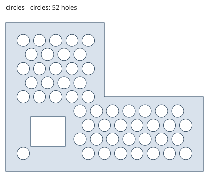
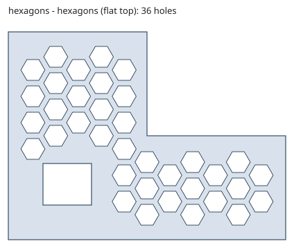
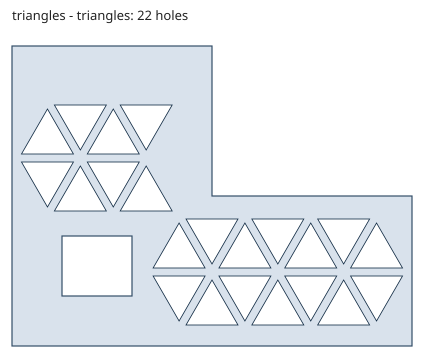

# Pattern previews

Generated by `tools/render_previews.py` from the same math the feature uses. Region: L-shape with a rectangular hole; cell 5-6 mm, rib 1.6 mm, max overhang 45 deg, max bridge 4 mm, edge margin = rib.

## Print Z across the holes (wall printed upright): bridges allowed

## Print Z 65 deg from the hole axis: no bridging, pointed roofs

## Print Z along the holes (plate printed flat): any shape

